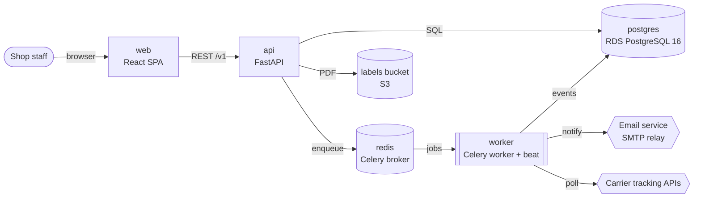
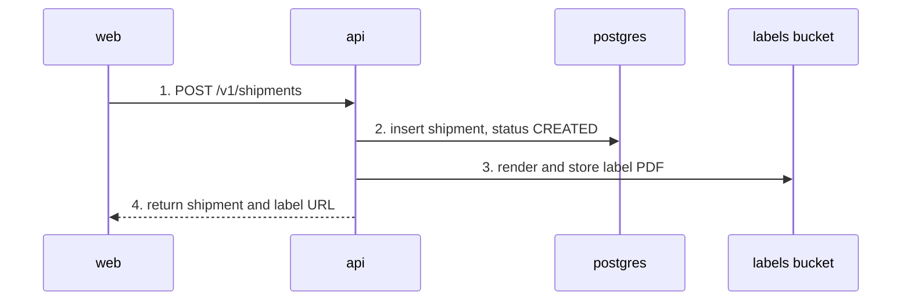
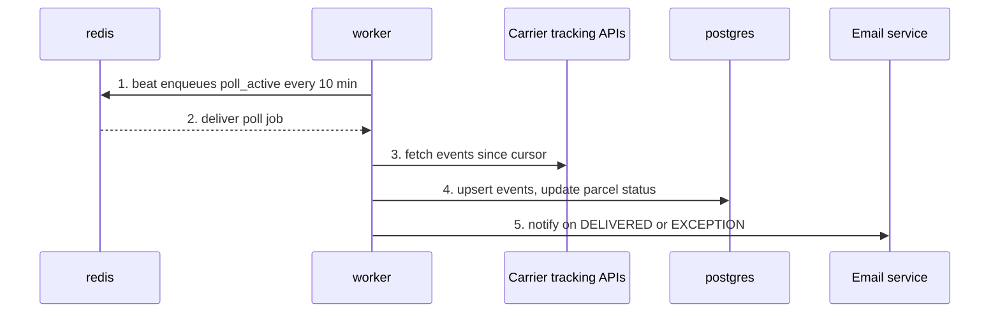
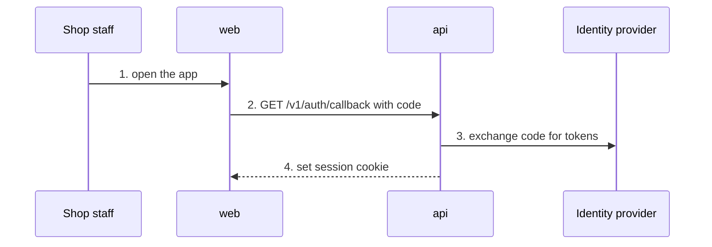
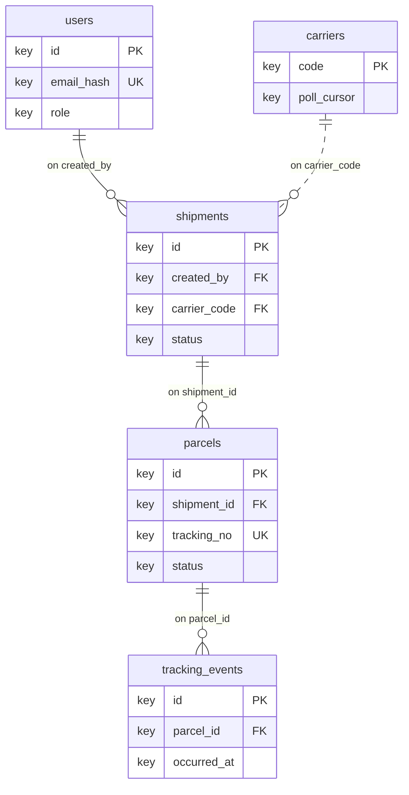

<!-- generated by darshan-singh-meel-docs-tech-summary 1.0.0 -->
# parcel-tracker: tech summary

Tech summary · ~9 min read · 2026-11-12 · commit a1b2c3d · graph knowledge graph at a1b2c3d

Python 3.12 · FastAPI and Celery on AWS ECS · staff orders and carrier events → labels, parcel status, emails

## 1 At a glance

One API, one worker and one database: staff create shipments in the web app, the worker keeps parcel status current from the carriers.

| Fact | Value |
|---|---|
| What | Creates shipments, prints labels and tracks parcels across carriers |
| Stack | Python 3.12 · FastAPI · Celery · PostgreSQL 16 · Redis 7 · React 18 |
| Runs on | AWS ECS Fargate in `eu-central-1`; staging and production |
| Schedule | API on demand; carrier poll every 10 min |
| In → out | staff orders, carrier events → label PDFs, parcel status, customer emails |
| Owner | Logistics platform team |

**Does**

- Creates shipments and A6 label PDFs
- Tracks parcel status from carrier APIs
- Emails customers on delivery or exception

**Doesn't**

- Manage orders: the shop system owns them
- Handle returns or refunds
- Bill carriers

**Limitations**

- Status lags the carrier by up to 10 min
- Up to 20 parcels per shipment
- Labels in one format: A6 PDF


- A shipment cannot change once its label exists; staff cancel and recreate it. (`api/services/shipments.py:77`)
- A parcel status only moves forward; an older carrier event never overwrites a newer one. (`worker/tasks/poll.py:58`)

## 2 Components

Six runtime parts; the API and the worker share one PostgreSQL database and talk through a Redis queue.

### Runtime components



Key: Grey fill = data store · dashed border = external system · pill = person

| Component | Does | Tech | Where |
|---|---|---|---|
| **web** | Shipment forms, label download, parcel timeline | React 18, Vite | `web/src/` |
| **api** | REST API, sign-in, label rendering; the only writer of shipments | FastAPI, SQLAlchemy 2 | `api/` |
| **worker** | Polls carriers, stores tracking events, sends emails | Celery 5 with beat | `worker/` |
| **postgres** | Shipments, parcels, tracking events, users | PostgreSQL 16 on RDS | `api/db/` |
| **redis** | Job queue between api and worker; no business data | Redis 7 on ElastiCache | `worker/app.py` |
| **labels bucket** | Label PDFs, read through presigned URLs | S3, SSE-S3 | `infra/storage/` |

## 3 Main flows

Three flows cover what a new engineer meets first: creating a shipment, tracking it, and signing in.

### Create a shipment and its label

The label must exist before staff leave the form: the carrier pickup scan needs it.



Key: Solid = call · dashed = reply · numbers = steps in the table below

| # | Step | Output | Where |
|---|---|---|---|
| 1 | POST /v1/shipments | validated order and address — If not: 422 with the failing fields | `api/routes/shipments.py:28` |
| 2 | insert shipment, status CREATED | `shipments` row and its parcels | `api/services/shipments.py:41` |
| 3 | render and store label PDF | `labels/SHP-1042.pdf` | `api/services/labels.py:17` |
| 4 | return shipment and label URL | 201, presigned URL valid 15 min | – |

**IN**

```
POST /v1/shipments
{"carrier": "CX", "parcels": [{"weight_g": 1200}],
 "to": {"postcode": "10115", "country": "DE"}}
```

**OUT**

```
201 Created
{"id": "SHP-1042", "status": "CREATED",
 "label_url": "https://<bucket>/labels/SHP-1042.pdf?X-Amz-Expires=900"}
```

_from tests/api/test_shipments.py::test_create_shipment (synthetic values)_

### Track parcel status

We poll every 10 minutes because two of the three carriers offer no webhooks.



Key: Solid = call · dashed = reply · numbers = steps in the table below

| # | Step | Output | Where |
|---|---|---|---|
| 1 | beat enqueues poll_active every 10 min | one job per carrier | `worker/schedules.py:9` |
| 2 | deliver poll job | carrier code and cursor | – |
| 3 | fetch events since cursor | new tracking events — If not: 429 → retry with backoff, at most 5 times | `worker/carriers/client.py:34` |
| 4 | upsert events, update parcel status | `tracking_events` rows, new `parcels.status` | `worker/tasks/poll.py:52` |
| 5 | notify on DELIVERED or EXCEPTION | one email per status change | `worker/tasks/notify.py:21` |

**IN**

```
carrier event
{"tracking_no": "CX123456789", "code": "DLV",
 "at": "2026-03-02T14:05:00Z"}
```

**OUT**

```
tracking_events: (parcel_id 77, DELIVERED, 2026-03-02 14:05)
parcels.status: IN_TRANSIT → DELIVERED
email: delivered template
```

_from tests/worker/test_poll.py::test_delivered_event (synthetic values)_

### Staff sign-in

Roles come from identity-provider groups, so access is granted in one place.



Key: Solid = call · dashed = reply · numbers = steps in the table below

| # | Step | Output | Where |
|---|---|---|---|
| 1 | open the app | redirect to sign-in (OIDC code flow) | – |
| 2 | GET /v1/auth/callback with code | authorization code and state | `api/auth/routes.py:15` |
| 3 | exchange code for tokens | ID token, 1 h — If not: 401 when state or nonce do not match | `api/auth/oidc.py:40` |
| 4 | set session cookie | HttpOnly cookie, role from `groups` claim | – |

## 4 Data model

Five tables; a shipment has parcels, a parcel has tracking events. Alembic owns the schema.

### Core tables (schema `tracker`)



Key: Solid = foreign key · dashed = logical link, not enforced · 1:N = one to many

| Entity | Keys |
|---|---|
| `users` | PK id, UK email_hash, role |
| `shipments` | PK id, FK created_by, FK carrier_code, status, + 9 columns |
| `parcels` | PK id, FK shipment_id, UK tracking_no, status, + 4 columns |
| `tracking_events` | PK id, FK parcel_id, occurred_at, + 3 columns |
| `carriers` | PK code, poll_cursor, + 2 columns |

- `tracking_events` is append-only; `parcels.status` holds the latest status.
- Recipient name and address live in `shipments`; they are personal data.
- Migrations: `api/db/migrations/` (Alembic).

## 5 Integrations

Four external systems; carrier keys and SMTP credentials are per environment in Secrets Manager.

| System | Direction | Via | Data | Auth |
|---|---|---|---|---|
| Carrier tracking APIs | out | HTTPS REST, polled | tracking events per parcel | API key per carrier |
| Email service | out | SMTP over TLS | delivery and exception emails | SMTP user `tracker-mailer` |
| Identity provider | both | OIDC code flow | staff identity, `groups` claim | client `parcel-tracker` |
| Shop system | in | CSV upload in web | orders to ship | staff session |

## 6 Tech stack

Versions as pinned in the repo; the lock files hold the exact builds.

| Layer | Tech | Version | Pinned in |
|---|---|---|---|
| Language | Python | `3.12` | `.python-version` |
| API | FastAPI | `0.115.*` | `pyproject.toml` |
| ORM and migrations | SQLAlchemy / Alembic | `2.0.* / 1.13.*` | `pyproject.toml` |
| Jobs | Celery | `5.4.*` | `pyproject.toml` |
| Database | PostgreSQL | `16` | `infra/db/main.tf` |
| Queue | Redis | `7.2` | `docker-compose.yml` |
| Frontend | React / Vite | `18.3 / 5.4` | `web/package.json` |
| Container | python:3.12-slim | `3.12-slim` | `Dockerfile` |
| Infra | Terraform / AWS provider | `>= 1.9 / ~> 5.0` | `infra/versions.tf` |
| CI | GitHub Actions | `not pinned` | `.github/workflows/deploy.yml` |

## 7 Deploy and environments

One image for api and worker; a merge to main deploys staging, a `v*` tag deploys production after approval.

| Environment | Runs on | Deploy | Access |
|---|---|---|---|
| local | docker compose (postgres, redis) + processes | see Run locally | localhost |
| staging | ECS Fargate, 1 api + 1 worker task | automatic on merge to `main` | VPN + SSO role `tracker-staging-dev` |
| production | ECS Fargate, 2 api + 2 worker tasks | tag `v*`, manual approval in CI | SSO role `tracker-prod-ops`, read-only by default |

- Pipeline: test → build image → push to ECR → `terraform apply` → ECS rolling update.
- Rollback: rerun the deploy job with the previous image tag.
- Healthy: `GET /healthz` returns 200 and the worker logs `beat: tick` every 10 min.
- Infra lives in `infra/`, one module per concern, one state per environment.

## 8 Security and access

Staff sign in with OIDC; three roles; no secret is stored in the repo.

| Topic | How it works | Where |
|---|---|---|
| Roles | `viewer`, `operator`, `admin` from the `groups` claim; checked per route | `api/auth/deps.py` |
| Secrets | Secrets Manager names `tracker/<env>/db`, `tracker/<env>/carrier-keys`; values `<redacted>` | `infra/secrets/` |
| Personal data | Recipient name and address encrypted at rest (RDS, S3 SSE) | `infra/db/`, `infra/storage/` |
| Label links | Presigned S3 URLs, valid 15 min; the bucket is private | `api/services/labels.py` |
| Network | api behind an ALB with TLS; worker has no inbound port | `infra/network/` |

## 9 Run locally

Docker for postgres and redis, the rest as local processes; about five minutes from clone to first shipment.

| Command | Does | Expect |
|---|---|---|
| `docker compose up -d postgres redis` | start the two stores | 2 containers healthy |
| `uv sync` | install Python dependencies from `uv.lock` |  |
| `uv run alembic upgrade head` | create the schema | Running upgrade -> 0012 |
| `uv run uvicorn api.main:app --reload` | start the API on port 8000 | Uvicorn running on http://127.0.0.1:8000 |
| `uv run celery -A worker.app worker -B -l info` | start worker and beat | celery@host ready |
| `npm --prefix web run dev` | start the web app | Local: http://localhost:5173/ |
| `uv run pytest` | run the test suite | all tests pass |

- Settings come from environment variables listed in `docs/config.md`; local values from the team vault.

## 10 Top risks

Polling cost and the deploy migration race matter most; both have a known fix.

| Risk | Impact | Status | Mitigation | Where |
|---|---|---|---|---|
| Migrations run at every container start | two tasks can migrate at once during a production deploy | Confirmed | run migrations as a one-off ECS task before the rollout | `api/entrypoint.sh:4` |
| Carrier rate limits as volume grows | 429s delay status by more than 10 min | Design risk | move carriers that offer them to webhooks | – |
| Duplicate carrier events | a customer may get two delivery emails | Not verified | unique key on carrier event id | `worker/tasks/poll.py:63` |
| Single Redis node without persistence | queued jobs lost on restart until the next beat tick | Design risk | acceptable today: beat re-enqueues within 10 min | – |
| Label PDFs kept without end | storage cost grows every month | Owner to decide | Owner to decide: retention period, then an S3 lifecycle rule | – |

## 11 Where to look next

| For | Go to | Why |
|---|---|---|
| Every setting and its default | `generated-docs/technical.html` → Configuration | full config table |
| Every endpoint with request and response | `api/routes/`; OpenAPI at `/docs` on a running api |  |
| Column-level data model | `api/db/models.py`, `api/db/migrations/` |  |
| Infra modules and state | `infra/` | one folder per module |
| Stuck polls, reruns, backfills | `generated-docs/technical.html` → Operations |  |
| Test layout and fixtures | `tests/` |  |
