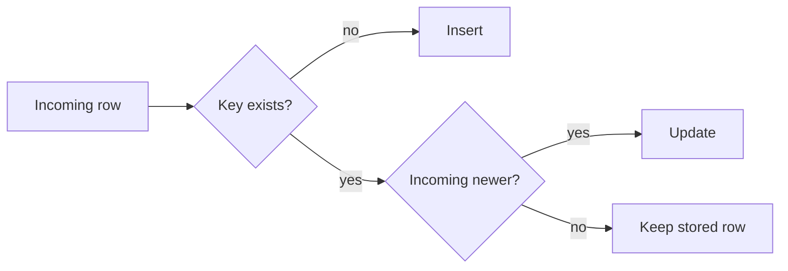

# Diagrams

## When
| Draw | Do not draw |
|---|---|
| A flow with a branch or a loop | A straight list of steps (numbered list) |
| Components and what talks to what (4+ parts) | Two boxes and an arrow |
| A sequence between 3+ actors over time | A comparison on attributes (table) |
| Before/after of a structure | A decorative "architecture" picture not referred to in the text |
| A data shape that changes (rows in, rows out) | Numbers in a chart with 2 values (sentence) |

- One figure, one idea; 5-9 nodes. More → split or cut detail.
- The text refers to the figure and says what to see in it. The figure uses the same names as the text and the code.
- A figure never carries a fact that the text or the code does not also carry.
- Screenshots: only for UI steps; crop, no personal data, no account ids.

## Mermaid or SVG
| Use | When |
|---|---|
| Mermaid block (` ```mermaid `) | Markdown output on a platform that renders it. GitHub does. Other platforms and site generators - check: the platform's docs. |
| SVG file `blog/<slug>-<name>.svg`, linked as an image | HTML output is asked for (the script inlines local `.svg`, and screenshots as base64; Mermaid cannot render without an external script), the platform does not render Mermaid, or the layout needs control |

- Render before delivery. Mermaid: with the platform's preview or `mmdc` (mermaid-cli) when installed; not rendered → say so in the reply. SVG: open the built HTML or the file in a browser (headless screenshot is enough) and look at it.

## Mermaid (syntax read on mermaid.js.org, see `sources.md`)

- Flowchart: `flowchart` + direction `TB`/`TD`, `BT`, `LR`, `RL`. Shapes: `id[text]` box, `id(text)` rounded, `id{text}` decision, `id[(text)]` database. Link text: `A -->|text| B`. Group: `subgraph title` ... `end`.
- Sequence: `sequenceDiagram`; `participant A as Name`; `A->>B: call`, `B-->>A: reply`; blocks `loop`, `alt`/`else`, `opt`, closed with `end`; `Note over A,B: text`.
- Traps:
  - The word `end` in lower case as node text breaks a flowchart: write `End` or `END`. In a sequence diagram wrap it: `(end)`, `[end]`.
  - A node id starting with `o` or `x` right after `---` makes a circle or cross edge (`A---oB`): add a space or capitalise.
  - Text with brackets, quotes or other special characters: wrap in double quotes, `id["text (with brackets)"]`.
  - Comments: `%%` on their own line.
- Short node ids, readable labels; left-to-right for pipelines, top-down for decisions with many branches.
- Under the block, one sentence that states what the diagram shows - Mermaid blocks have no alt text in Markdown.

## SVG
- Hand-written, one file, `viewBox` set, no fixed pixel width, no external fonts, images or scripts; `<title>` and `<desc>` as first children; text as `<text>`, not paths.
- Font `system-ui, sans-serif`, 13-15 px at a 720-wide viewBox; dark text on white or a light fill; line width 1.5-2.
- Meaning never by colour alone: label every node and every edge that branches. At most 3 fill colours.
- Check geometry: every label inside its box with padding (about 7.5 px per character at 14 px), no overlaps, arrows end at box edges, even spacing.
- Markdown: `` on its own line. The alt text states the content ("Decision flow: insert when the key is new, update when the incoming row is newer, else keep"), not "diagram".
