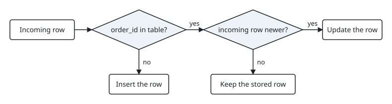

<!-- brief: reader=data engineers who write Python load jobs and SQL but have not used ON CONFLICT; goal=write a load that can run twice without duplicates, crashes or stale overwrites; thesis=A batch load is safe to rerun when the table has a natural key and the insert is an UPSERT guarded by a timestamp; type=tutorial; words=600-900 -->

# Make a batch load safe to rerun with SQLite UPSERT

Load jobs get retried: a scheduler restarts a failed task, or someone reruns yesterday's file. A plain `INSERT` then either duplicates every row or crashes on the first one. Give the table a natural key and write the insert as an UPSERT with a timestamp guard, and a rerun changes nothing. This post shows both failures and the fix, with code you can run.

## What you need

- Python 3.12 with the standard-library `sqlite3` module. The examples ran on Python 3.12.10 with SQLite 3.49.1.
- SQLite 3.24.0 or later. [UPSERT was added in version 3.24.0](https://sqlite.org/lang_upsert.html) (2018-06-04).

Save the blocks below as two files, `naive.py` and `load.py`.

## A plain insert fails in two ways

`naive.py` loads the same three orders twice, first into a table without a key, then into a table with a primary key:

```python
import sqlite3

batch = [("A-1", "new", 4000), ("A-2", "new", 1550), ("A-3", "paid", 9900)]
INSERT = "INSERT INTO orders VALUES (?, ?, ?)"
COUNT = "SELECT count(*) FROM orders"

con = sqlite3.connect(":memory:")
con.execute("CREATE TABLE orders (order_id TEXT, status TEXT, cents INTEGER)")
con.executemany(INSERT, batch)
con.executemany(INSERT, batch)  # the retry
print("no key:", con.execute(COUNT).fetchone()[0], "rows")

con.execute("DROP TABLE orders")
con.execute(
    "CREATE TABLE orders "
    "(order_id TEXT PRIMARY KEY, status TEXT, cents INTEGER)"
)
con.executemany(INSERT, batch)
try:
    con.executemany(INSERT, batch)  # the retry
except sqlite3.IntegrityError as error:
    print("with key:", type(error).__name__, "-", error)
```

```text
no key: 6 rows
with key: IntegrityError - UNIQUE constraint failed: orders.order_id
```

Without a key, the retry doubles the table. With a key, the retry raises `sqlite3.IntegrityError`. Neither load can run twice.

## Let the key decide between insert and update

An UPSERT is an `INSERT` with an `ON CONFLICT` clause. The SQLite documentation says it "causes the INSERT to behave as an UPDATE or a no-op if the INSERT would violate a uniqueness constraint". The table needs that constraint, so `order_id` is the primary key. `load.py` starts with the table and the statement:

```python
import sqlite3

SCHEMA = """
CREATE TABLE orders (
    order_id     TEXT PRIMARY KEY,
    status       TEXT NOT NULL,
    amount_cents INTEGER NOT NULL,
    updated_at   TEXT NOT NULL
)
"""

UPSERT = """
INSERT INTO orders (order_id, status, amount_cents, updated_at)
VALUES (:order_id, :status, :amount_cents, :updated_at)
ON CONFLICT (order_id) DO UPDATE SET
    status       = excluded.status,
    amount_cents = excluded.amount_cents,
    updated_at   = excluded.updated_at
WHERE excluded.updated_at > orders.updated_at
"""
```

Two details carry the logic:

- `excluded.status` is the value the insert tried to write. An unqualified `status` is the value already stored.
- The `WHERE` clause is the guard. When the incoming row is not newer than the stored row, the update becomes a no-op.

The figure shows the three outcomes for an incoming row.



The guard compares `updated_at` as text. That orders rows by time only if every timestamp has the same ISO 8601 format and time zone, as the UTC values here do.

`INSERT OR REPLACE` also survives a rerun, but its [REPLACE algorithm](https://sqlite.org/lang_conflict.html) "deletes pre-existing rows that are causing the constraint violation" and inserts the new row. It cannot keep a column the batch does not carry, and it has no guard: an older row replaces a newer one.

## Load each batch in one transaction

`load.py` continues with the load function:

```python
def load(con, batch):
    with con:
        con.executemany(UPSERT, batch)
```

`with con:` commits when the block finishes and rolls back when it raises, so a batch loads completely or not at all. It does [not close the connection](https://docs.python.org/3.12/library/sqlite3.html#how-to-use-the-connection-context-manager). The [named placeholders](https://docs.python.org/3.12/library/sqlite3.html#how-to-use-placeholders-to-bind-values-in-sql-queries) (`:order_id`) take one dict per row; `order()` in the next block builds them.

## Rerun it and compare

The rest of `load.py` loads Monday's batch twice, then Tuesday's batch twice. Tuesday's batch holds one newer row (`A-2`), one row older than the stored one (`A-3`), and one new key (`A-4`):

```python
def show(con, label):
    print(label)
    for row in con.execute("SELECT * FROM orders ORDER BY order_id"):
        print("  ", row)


def order(order_id, status, amount_cents, updated_at):
    return {
        "order_id": order_id,
        "status": status,
        "amount_cents": amount_cents,
        "updated_at": updated_at,
    }


monday = [
    order("A-1", "new", 4000, "2026-03-02T09:00:00Z"),
    order("A-2", "new", 1550, "2026-03-02T09:05:00Z"),
    order("A-3", "paid", 9900, "2026-03-02T09:10:00Z"),
]
tuesday = [
    order("A-2", "shipped", 1550, "2026-03-03T08:00:00Z"),  # newer: update
    order("A-3", "new", 9900, "2026-03-02T09:07:00Z"),  # older: keep stored row
    order("A-4", "new", 700, "2026-03-03T08:30:00Z"),  # unknown key: insert
]

con = sqlite3.connect(":memory:")
print("SQLite", sqlite3.sqlite_version)
con.execute(SCHEMA)

load(con, monday)
show(con, "monday batch")
load(con, monday)
show(con, "monday batch, rerun")
load(con, tuesday)
show(con, "tuesday batch")
load(con, tuesday)
show(con, "tuesday batch, rerun")
```

Run `python load.py`:

```text
SQLite 3.49.1
monday batch
   ('A-1', 'new', 4000, '2026-03-02T09:00:00Z')
   ('A-2', 'new', 1550, '2026-03-02T09:05:00Z')
   ('A-3', 'paid', 9900, '2026-03-02T09:10:00Z')
monday batch, rerun
   ('A-1', 'new', 4000, '2026-03-02T09:00:00Z')
   ('A-2', 'new', 1550, '2026-03-02T09:05:00Z')
   ('A-3', 'paid', 9900, '2026-03-02T09:10:00Z')
tuesday batch
   ('A-1', 'new', 4000, '2026-03-02T09:00:00Z')
   ('A-2', 'shipped', 1550, '2026-03-03T08:00:00Z')
   ('A-3', 'paid', 9900, '2026-03-02T09:10:00Z')
   ('A-4', 'new', 700, '2026-03-03T08:30:00Z')
tuesday batch, rerun
   ('A-1', 'new', 4000, '2026-03-02T09:00:00Z')
   ('A-2', 'shipped', 1550, '2026-03-03T08:00:00Z')
   ('A-3', 'paid', 9900, '2026-03-02T09:10:00Z')
   ('A-4', 'new', 700, '2026-03-03T08:30:00Z')
```

The Monday rerun leaves three rows. Tuesday's batch updates `A-2`, inserts `A-4`, and leaves `A-3` as `paid`: the late-arriving older row does not overwrite it. The Tuesday rerun prints the same four rows.

## Where this stops working

- UPSERT handles uniqueness conflicts only. A `NOT NULL`, `CHECK` or foreign-key violation still fails the batch.
- It never deletes. A row removed at the source stays in the table; that needs a delete marker in the feed or a separate reconciliation.
- The guard needs a trustworthy `updated_at`. Without one, drop the `WHERE` and accept last-write-wins.
- `ON CONFLICT` is not standard SQL. SQLite follows PostgreSQL's syntax; check your database's documentation before porting the statement.

## Takeaways

- Give every loaded table a natural key; without one, no statement can tell a retry from new data.
- Write the load as `INSERT ... ON CONFLICT (key) DO UPDATE`, and refer to incoming values as `excluded.<column>`.
- Add `WHERE excluded.updated_at > <table>.updated_at` when rows can arrive late or out of order.
- Wrap each batch in one transaction so a failed load leaves nothing half-written.
- Test the property directly: run the load twice and compare the table.
